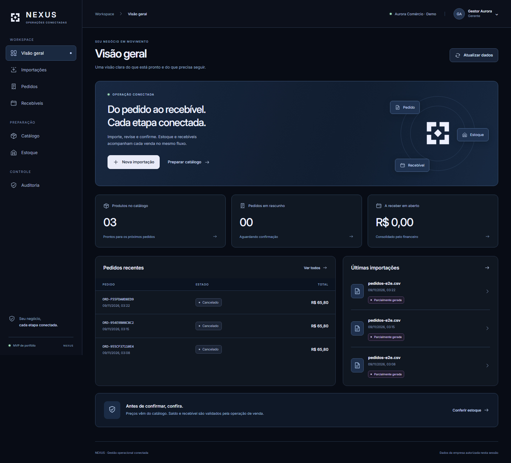

# NEXUS — vendas, estoque e recebíveis

**MVP full stack com React/TypeScript, FastAPI e PostgreSQL.** Uma venda confirmada precisa atualizar estoque e financeiro de forma consistente. O NEXUS conecta essas etapas com permissões, isolamento por empresa e trilha de auditoria.

[**Experimentar o aplicativo**](https://nexus-portfolio-ui.onrender.com/) · [Guia local](docs/LOCAL_DEMO.md) · [Documentação](docs/README.md)



## Avalie a jornada

1. Crie sua conta; no cadastro por e-mail, confirme pelo link ou código recebido.
2. Use dados fictícios. Siga o [roteiro e os arquivos de demonstração](docs/LOCAL_DEMO.md) para preparar clientes, produtos e estoque.
3. Importe pedidos CSV, revise os problemas e gere rascunhos.
4. Confirme uma venda e confira o movimento de estoque e o recebível.
5. Cancele a venda e confira a reversão dos efeitos e a auditoria.

Cada conta recebe um workspace privado. O plano gratuito pode levar algum tempo para iniciar. A interface usa Supabase Auth; a API e os dados de negócio usam Render e PostgreSQL no Neon.

## O que demonstra tecnicamente

| Decisão | Código e evidências |
| --- | --- |
| Coordenar confirmação/cancelamento com transação, bloqueio e valores `Decimal` | [Serviço de vendas](backend/app/services/sales_service.py), [testes](backend/tests/test_sales.py) |
| Restringir acesso por papel e empresa | [Testes RBAC](backend/tests/test_rbac.py), [isolamento em vendas](backend/tests/test_sales.py) |
| Versionar persistência | [Migrações Alembic](backend/alembic/versions), [testes de persistência](backend/tests/test_persistence.py) |
| Verificar a jornada integrada | [Playwright E2E](frontend/e2e/portfolio-flow.spec.ts), [validação da interface](docs/VALIDATION_UI.md) |
| Reproduzir verificações com banco real | [CI backend SQLite/PostgreSQL](.github/workflows/backend.yml), [CI frontend/E2E](.github/workflows/frontend.yml) |

## Executar e verificar

O [guia local](docs/LOCAL_DEMO.md) prepara a jornada com PostgreSQL, seed e interface. Requer Python 3.12, Node 24.15+ na linha 24 e Docker Compose. A configuração detalhada de desenvolvimento, SQLite e autenticação está no [guia técnico](README_TECHNICAL.md#executar-localmente).

Backend, após instalar suas dependências e configurar o banco:

```bash
cd backend
python -m alembic upgrade head
python -m pytest -q
python -m alembic check
```

Frontend, em outro terminal:

```bash
cd frontend
npm ci
npm test -- --run
npm run typecheck
npm run build
```

## Estado e limites

O repositório registra a validação da jornada pública, isolamento, persistência após redeploy e ensaio de backup/restauração em [M5](docs/VALIDATION_M5.md). A evolução da autenticação está na [release de 15/11](docs/RELEASE_AUTH_2026-11-15.md).

Esses registros descrevem validações realizadas, não disponibilidade garantida. Recuperação completa de senha, medição de cold start e vídeo final continuam pendentes. Workers/Redis, IA, AWS, desktop e offline estão fora da jornada pública demonstrada.

**Foco de portfólio:** regras de negócio, transações, autorização e integração frontend/backend. [Arquitetura, operação, limites e histórico](docs/README.md).
