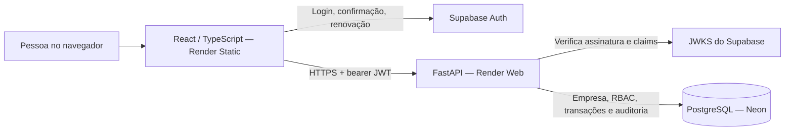

# Avaliar o NEXUS

O fluxo principal conecta uma venda ao estoque e ao recebível, com cancelamento
que reverte os efeitos. Use somente dados fictícios.

[Abrir aplicação](https://nexus-portfolio-ui.onrender.com/) ·
[Vídeo da jornada local — 33 s](media/2026-11-16/nexus-jornada.mp4) ·
[Evidências desta revisão](VALIDATION_M6_2026-11-16.md)

## Entrar e preparar um workspace

Entre com Google, GitHub ou e-mail. Cada conta recebe um workspace privado vazio;
sem convite ou senha de demonstração pública. No cadastro por e-mail, confirme
pelo botão ou código recebido. Há reenvio e confirmação por código na tela inicial.

Para reproduzir o exemplo pelo aplicativo público:

1. Em **Catálogo**, cadastre “Café especial 250g”, SKU `PROD-A`, preço `32,90` e
   custo `18,70`. Os campos numéricos seguem a convenção do seu navegador.
2. Em **Estoque → Novo depósito**, cadastre “Depósito principal”, código `PRINCIPAL`.
3. Em **Preparar saldo inicial**, selecione esse produto e depósito, tipo **Entrada de mercadoria**,
   quantidade `10`. Confira o saldo antes de vender.
4. Baixe [orders-with-errors.csv](../demo/orders-with-errors.csv). Ele contém um
   pedido válido de duas unidades de PROD-A e pedidos inválidos para demonstrar
   SKU desconhecido e quantidade zero. Não é necessário cadastrar PROD-B para
   demonstrar o pedido válido desse arquivo.

Cliente é opcional para os pedidos importados. O vídeo usa o seed local com 120
unidades iniciais; esse saldo não é criado automaticamente no site público.

## Executar a jornada

| Ação | Resultado a conferir |
| --- | --- |
| Importações → enviar CSV → Revisar arquivo | Problemas aparecem por pedido; inválidos não podem ser selecionados |
| Selecionar apenas DEMO-001 → gerar rascunho | Pedido disponível; saldo ainda 10, nenhum recebível desse pedido |
| Abrir pedido → depósito → prazo 30 dias → confirmar venda | Estado confirmado; saldo 8; recebível de R$ 65,80 |
| Recebíveis / Estoque | Efeitos visíveis nos respectivos módulos |
| Voltar ao pedido → cancelar → confirmar operação | Estado cancelado; saldo volta a 10; recebível fica cancelado |
| Auditoria | Operações rastreáveis dentro da empresa |

Não recrie a mesma referência externa para tentar contornar um erro: a
idempotência evita duplicação. Para nova demonstração, altere as referências no
CSV ou consulte os registros já salvos. Se houver falha de comunicação, consulte
o estado salvo antes de decidir repetir uma operação.

## O que vale examinar no código

- [Venda e cancelamento](../backend/app/services/sales_service.py): transações,
  bloqueio de saldo e cálculos com Decimal.
- [Revisão de importações](../backend/app/services/order_import_service.py):
  validação, revisão persistida e geração idempotente de rascunhos.
- [Autorização](../backend/app/identity/dependencies.py) e
  [testes RBAC](../backend/tests/test_rbac.py): empresa e permissões verificadas
  pela API, além dos controles da interface.
- [Jornada automatizada](../frontend/e2e/portfolio-flow.spec.ts): estoque e
  recebível verificados pela API, acesso entre empresas recusado.

## Arquitetura do recorte publicado

A API não confia em company_id/role enviados como metadados editáveis da identidade.
Tokens ficam por aba; recarregar a mesma aba preserva a sessão Supabase, fechar a
aba exige novo login. Não há conexão direta do navegador ao banco de negócio.

O plano gratuito pode precisar iniciar o serviço. Redis/workers permanentes, IA,
AWS e offline não fazem parte desta jornada pública. Entrega do novo e-mail a um
destinatário real e recuperação completa de senha ainda têm limites de homologação
registrados no [handoff](../HANDOFF_2026-11-16.md).
