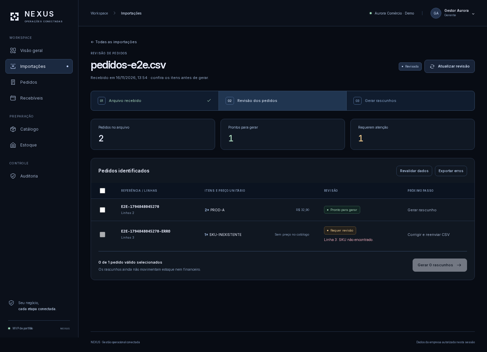
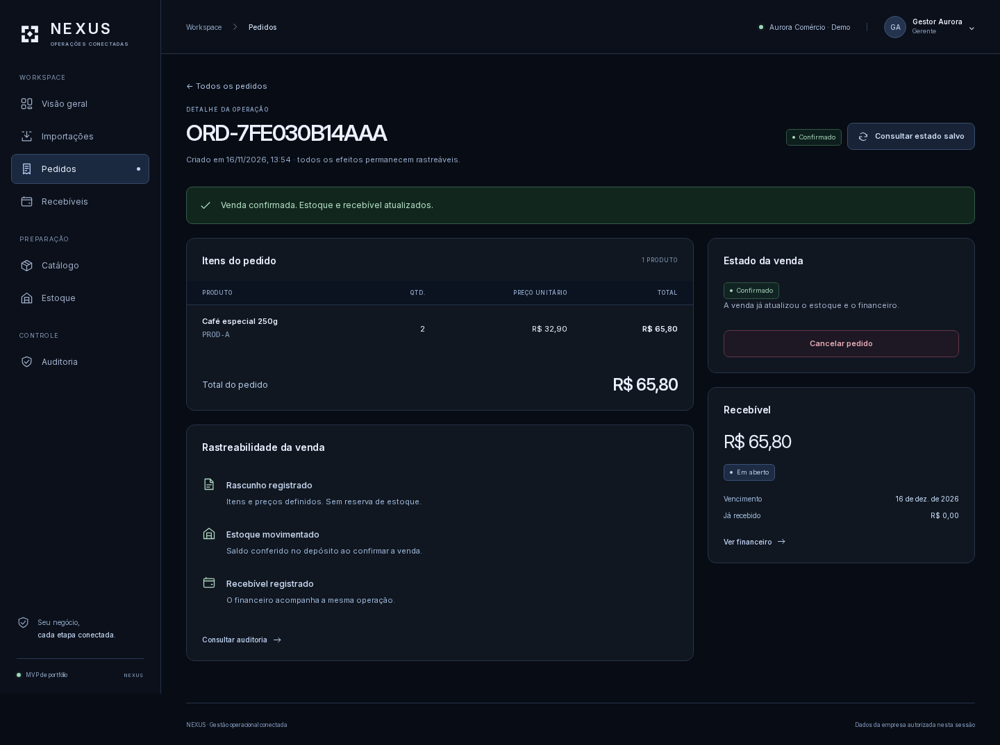
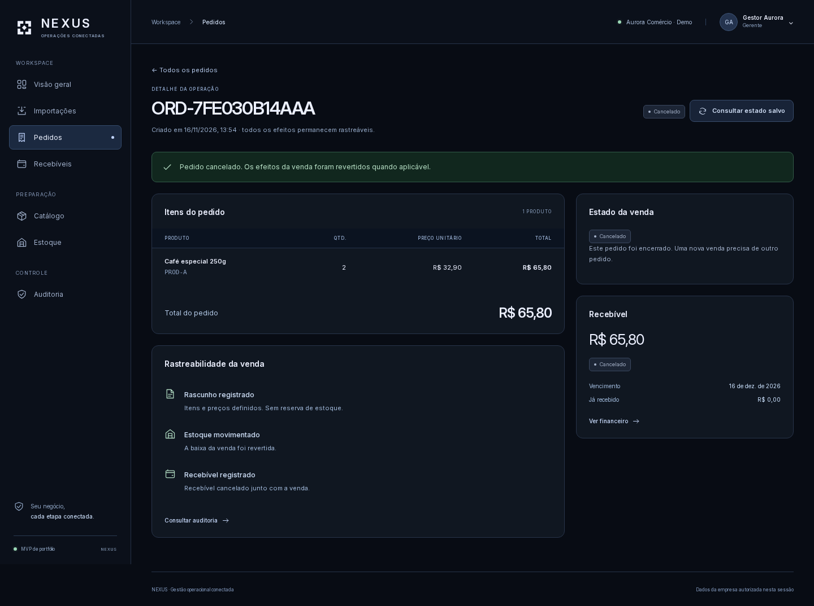
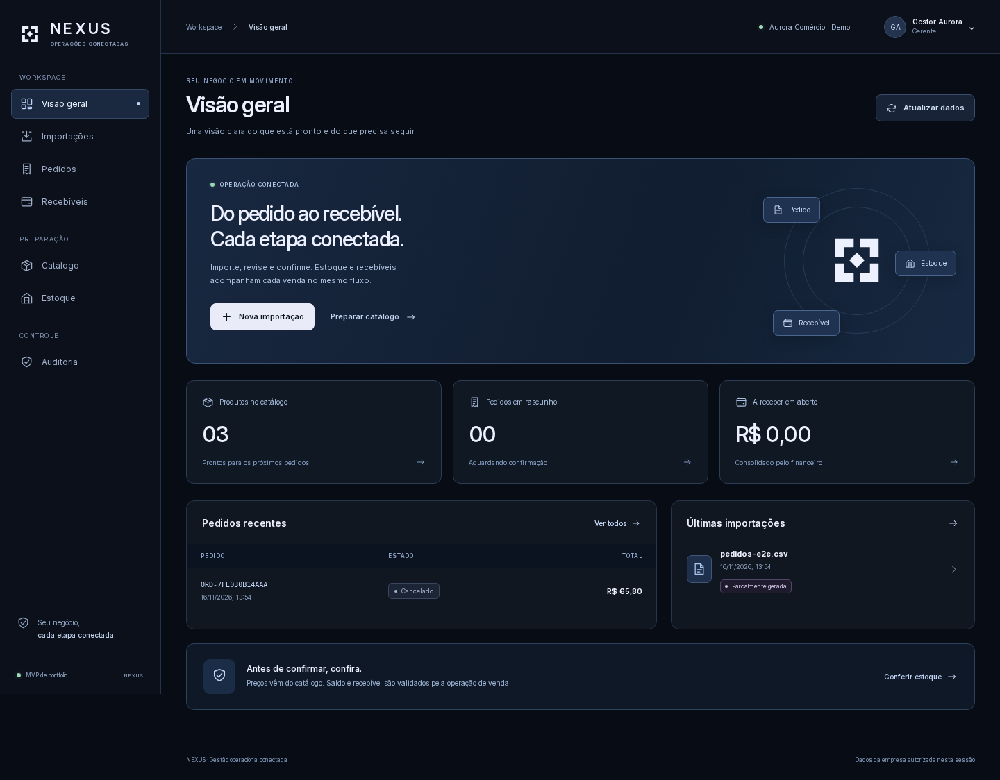

# NEXUS — jornada de portfólio

Capturado em 16/11/2026, código `afd94f2`, API e PostgreSQL locais, dados fictícios.
Conta Gestor Aurora / empresa Aurora Comércio · Demo; outra empresa usada para
validar isolamento. Autenticação legacy local, não a tela Supabase pública.

[**Assistir ao vídeo — 33 segundos, MP4 com legendas**](nexus-jornada.mp4)

## Revisar e impedir o pedido inválido

## Confirmar a venda

## Cancelar e reverter

## Visão geral e mobile

[Visão geral mobile](ui-overview-mobile.png) · [Entrada local mobile](ui-login-mobile.png)

As capturas são imagens diretas do navegador, sem composição de dados. O vídeo
adiciona uma faixa de legendas abaixo da gravação; mantém a sequência de ações.
Há pausas de leitura, sem aceleração. O login usa senha fictícia mascarada.
Não representa autenticação Supabase/OAuth nem experiência de cold start.

[Resultados e reprodução](../../VALIDATION_M6_2026-11-16.md) ·
[Roteiro no site público](../../AVALIAR_NEXUS.md) ·
[Manifesto SHA-256](SHA256SUMS)
